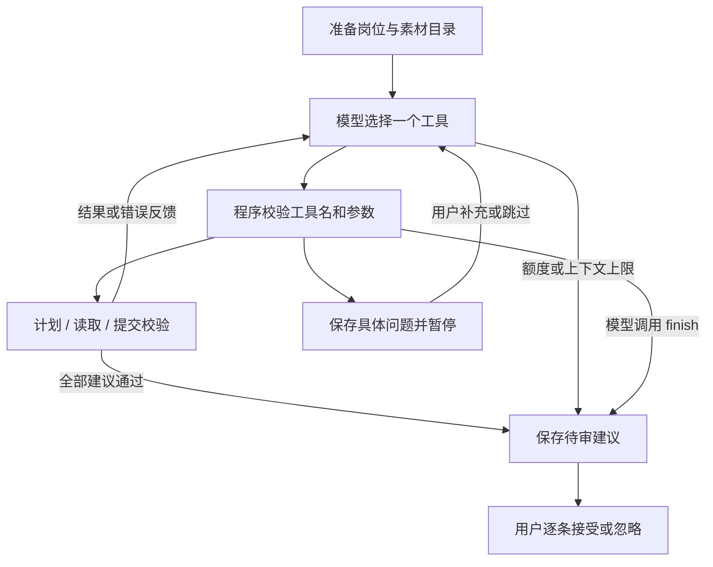

# 简历 Agent：实现方式与学习路线

本功能参考 [Deep Agents JS](https://github.com/langchain-ai/deepagentsjs) 的任务规划、工具循环和上下文管理方式，使用项目现有的 LangGraph JS 实现。没有安装或调用 `deepagents` SDK，也没有复制其源码。模型仍使用本机配置的 DeepSeek。

## 如何使用

1. 在简历工作台保存目标岗位、JD 和已选素材。
2. 点击「Agent 优化（最多 8 次请求）」。这次点击授权本次有上限的多轮处理；只发送岗位信息、已选素材和本次补充事实。
3. 查看行动计划与执行记录。如果助手提出具体问题，可以补充真实事实，也可以留空继续。
4. 查看原文、修改建议和引用依据，逐条接受或忽略。建议不会自动覆盖正式条目。

「快速优化」保留原有固定流程，最多两次调用。「补充事实后重写此条」仍走原有单条流程。旧任务继续通过旧图恢复，新 Agent 任务使用独立流程版本。

## 这次参考了什么

Deep Agents JS 提供任务规划、文件系统上下文、子 Agent 等能力，并建立在 LangGraph 之上。本次采用其中适合简历优化的部分：

| Deep Agents 中的方式 | 本项目落地 |
| --- | --- |
| 维护待办计划 | `write_plan`：模型制定和更新短计划 |
| 工具调用循环 | 模型选择工具，程序执行，将结果返回模型，再选择下一步 |
| 按需获取上下文 | 首轮只给素材目录，通过 `read_materials` 读取已选素材全文 |
| 状态持久化与人工参与 | SQLite Checkpointer + `interrupt` + `Command({resume})` |

这不是完整 Deep Agents 运行环境。本次没有提供任意文件访问、终端、联网检索、子 Agent、向量库、跨任务长期记忆或后台执行。素材工具只访问本次运行的不可变快照。

## 核心知识

### 1. Workflow 与 Agent 的区别

快速优化是预先规定路径的工作流：生成 → 校验 → 必要时修正。

Agent 仍运行在程序规定的安全边界内，但具体下一步由模型选择。例如，它可以先批量读取素材，发现缺少结果数据后追问，再根据工具返回的错误修正提交。模型选择动作，程序决定动作是否允许并真正执行。

### 2. Tool Calling：模型不会直接执行函数

服务端把工具名称、说明和 JSON Schema 发给模型。模型返回 `tool_calls`，包含工具名、JSON 参数及调用 ID。程序校验并执行白名单中的工具，再发送带相同 `tool_call_id` 的结果。这个结果是下一轮的观察信息。

本次有五个工具：

- `write_plan`：维护最多八项行动计划。
- `read_materials`：按 ID 批量读取已授权素材。
- `request_user_facts`：针对已读素材提出具体问题，最多两次。
- `propose_changes`：批量提交结构化建议及逐字依据。
- `finish`：结束，未通过的条目保留原文。

每轮只执行一个工具；模型同时返回多个时，每个调用都会收到错误反馈，本轮不执行。这样可以明确记录动作顺序和暂停位置。

### 3. 结构化输出需要多层校验

JSON Schema 帮助模型理解参数形状，不能代替服务端校验。本实现使用普通 Tool Calling，没有启用 DeepSeek Beta 的 `strict` 模式。

| 层次 | 检查内容 | 失败处理 |
| --- | --- | --- |
| API 响应 | 是否包含可识别的消息和工具调用 | 保存为失败状态，可手动恢复 |
| 工具参数 | JSON 可解析、Zod 类型、数量和长度限制 | 把错误返回模型，在剩余额度内重新生成 |
| 工具权限 | 白名单、只能读取已选素材、先读再提交、先制定计划 | 返回错误，要求修正 |
| 简历结构 | 素材 ID、字段完整、固定事实不变、空字段不填充 | 失败条目反馈模型，已通过的条目保留 |
| 引用出处 | 引文必须逐字出现在同一素材或用户补充中 | 拒绝该条建议，反馈模型 |
| 语义与真实性 | 修改后是否扩大职责、是否真实表达经历 | 用户对照原文与依据审阅 |

引用校验只证明出处存在，不能证明整段改写完全受该引用支持。尤其是数字、因果关系和职责范围，不能宣称通过结构校验就自动防止幻觉。

### 4. Checkpointer、thread_id 与恢复

业务运行记录在 `data/ownspace.db` 的 `resume_ai_runs` 中；图的状态在 `data/langgraph-checkpoints.db`，使用 `SqliteSaver`，不是仅内存保存。测试才主要使用内存数据库。

每次优化生成唯一 `run.id`，并将它作为 `configurable.thread_id`。恢复时读取相同 `run.id` 对应的最新 checkpoint。图状态包含消息、行动计划、已读素材 ID、补充事实、候选建议、引用、待回答问题及调用进度。密钥不写入状态。

流程版本区分 `resume-recovery-v1` 和 `resume-agent-v1`。恢复还会检查任务输入版本和执行占用标识，避免过期任务覆盖新输入。

人工暂停用 `interrupt`，用户提交后用 `Command({resume: answer})` 恢复。没有提交答案的恢复请求仍保持等待；显式留空才代表跳过。被中断的节点会从头执行，所以模型调用不放在暂停节点中。

完成节点采用同步持久化。进程在远端模型响应之后、本地 checkpoint 保存之前崩溃，仍可能需要再次请求模型；这里不承诺外部 API 的“恰好一次”执行。业务数据库在请求前预扣次数，失败和恢复都不会重置额度。

### 5. Budget：约束成本和终止条件

整个运行最多八次模型请求，包括工具参数错误后的修正和失败的网络请求。达到上限保留已通过建议，其他条目回退原文。另有两次追问、初始输入 40,000 字符、累积消息 120,000 字符的限制；不会悄悄截断简历内容。这是字符预算，不是精确 token 或费用预算。

上下文超过上限会结束；网络错误需要用户点击恢复，不在后台无限重试。恢复前还会核对模型配置是否与开始时一致。

### 6. Context 与 Memory

本次把“素材目录”和“素材全文”分开，模型按需调用工具读取，是简单的上下文管理。Checkpoint 保存的是本次任务状态，不能等同于跨任务记忆。这里没有向量检索，也没有自动总结旧对话。

### 7. 可观测性与评估

页面展示计划、实际工具执行摘要、引用依据、调用次数和 token 用量。计划状态由模型维护，执行摘要由程序产生；这些不是模型的隐藏思维过程。完整消息只保存在本地 checkpoint，不发送到前端展示。

单元与集成测试使用模拟模型响应，验证越权素材、伪造引用、固定事实修改、无效 JSON 修正、次数上限、人工暂停、SQLite 关闭后重开恢复，以及完成任务不重复调用。后续评估可用人工标注的匿名简历/JD 样本，比较事实保留率、建议接受率、任务成功率和调用成本；本次没有声称实际文本质量已通过这类评估。

## 代码阅读顺序

1. `src/features/resumes/agent/contracts.ts`：工具契约、可展示状态与预算。
2. `src/features/resumes/agent/provider.ts`：DeepSeek 原生工具调用协议。
3. `src/features/resumes/agent/tools.ts`：白名单分派、校验与错误反馈。
4. `src/features/resumes/agent/graph.ts`：模型—工具循环、暂停与恢复。
5. `src/features/resumes/workflow/recovery-service.ts`：持久化次数、输入版本与执行占用。
6. `src/features/resumes/components/agent-progress.tsx`：计划、执行记录和依据展示。
7. `test/resumes/agent*.test.ts`：通过模拟响应理解每条分支。

## 官方资料

- [Deep Agents JS 源码与说明](https://github.com/langchain-ai/deepagentsjs)
- [Deep Agents JS 总览](https://docs.langchain.com/oss/javascript/deepagents/overview)
- [LangGraph 持久化](https://docs.langchain.com/oss/javascript/langgraph/persistence)
- [LangGraph 人工中断与恢复](https://docs.langchain.com/oss/javascript/langgraph/interrupts)
- [DeepSeek Tool Calls](https://api-docs.deepseek.com/guides/tool_calls/)

没有新增依赖、环境变量或数据库表；安装和启动方式不变。运行需要配置现有 DeepSeek Key，并使用支持 Tool Calling 的模型。自动化验证未使用真实简历调用外部模型，真实提供方兼容性和建议质量仍需在你主动点击后观察。
